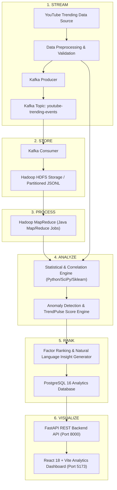
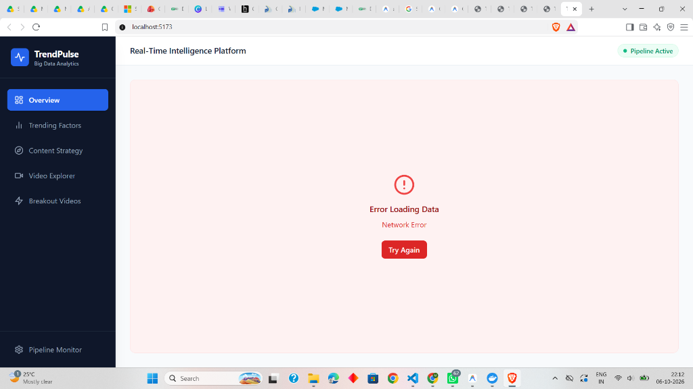

# TrendPulse – Real-Time YouTube Trending Intelligence & Video Lifecycle Analytics Platform

[](https://www.python.org/)
[](https://fastapi.tiangolo.com/)
[](https://react.dev/)
[](https://www.docker.com/)
[](https://kafka.apache.org/)
[](https://hadoop.apache.org/)
[](LICENSE)

**Author / Developer**: [meghana-pb](https://github.com/meghana-pb)  
**Repository**: [https://github.com/meghana-pb/trendpulse-youtube-big-data-analytics](https://github.com/meghana-pb/trendpulse-youtube-big-data-analytics)

---

## 📌 1. Project Overview

**TrendPulse** is a Big Data Analytics platform designed to analyze YouTube trending video metadata and identify video attributes associated with longer trending duration. 

YouTube's trending feed features videos that capture widespread audience interest. Understanding why certain videos sustain trending status for days while others drop off rapidly is a key challenge for content strategists, digital marketers, and media analysts. TrendPulse addresses this by processing multi-attribute video metrics—such as category, publication timing, title characteristics, view accumulation, and engagement rates—through a distributed Big Data ingestion, storage, processing, and statistical analytics pipeline.

> ⚠️ **Important Methodology Note**: **Correlation ≠ Causation**. TrendPulse uses rigorous statistical techniques (Pearson correlation, Spearman rank correlation, ANOVA F-tests, Eta-squared effect sizes, and Mutual Information) to measure associations between video attributes and trending persistence. These statistical rankings highlight attributes strongly linked with long trending spans, but do not prove direct causality.

---

## 🏗️ 2. Big Data System Architecture

The project is structured around six core operational stages:

$$\text{STREAM} \longrightarrow \text{STORE} \longrightarrow \text{PROCESS} \longrightarrow \text{ANALYZE} \longrightarrow \text{RANK} \longrightarrow \text{VISUALIZE}$$



### Stage Descriptions
1. **STREAM**: Apache Kafka ingests high-throughput streaming events representing video observations, appending metadata like ingestion timestamp, partition key, and source tracking.
2. **STORE**: Distributed storing of raw and ingested observation records in Apache Hadoop HDFS under partitioned directory structures (`/youtube-trending/raw/year=YYYY/month=MM/day=DD/`).
3. **PROCESS**: Apache Hadoop MapReduce (Java) runs distributed aggregations per category, publication window, title length bucket, and engagement tier.
4. **ANALYZE**: Python Statistical Engine calculates Pearson correlation, Spearman rank correlation, ANOVA F-tests, Eta-squared effect sizes, and Mutual Information across 20+ features.
5. **RANK**: Combines statistical significance, effect size, and consistency into a unified composite ranking score to evaluate factor impact and detect breakout video anomalies.
6. **VISUALIZE**: React 18 dashboard presents interactive visualizations, metric summaries, heatmaps, search tools, and live pipeline status updates.

---

## 💻 3. Technology Stack

| Domain | Technologies |
| :--- | :--- |
| **Ingestion & Streaming** | Apache Kafka 7.7.0, Confluent Zookeeper, `kafka-python` |
| **Storage & Distributed Processing** | Apache Hadoop 3.3.6 (HDFS & MapReduce Java API), Maven |
| **Data Preprocessing & Validation** | Python 3.11+, Pandas, NumPy, Scikit-learn, Custom Quality Validators |
| **Statistical Analytics** | SciPy (Stats & ANOVA), Scikit-learn (Mutual Info & Scalers), IQR Anomaly Scoring |
| **Database & ORM** | PostgreSQL 16 Alpine, SQLAlchemy 2.0 (Async & Core), Psycopg2 |
| **Backend API** | FastAPI, Pydantic V2, Uvicorn |
| **Frontend Dashboard** | React 18, Vite, Tailwind CSS, Recharts, Lucide React, Axios |
| **Containerization & Dev Tools** | Docker, Docker Compose, Pytest |

---

## 🔍 4. Component Implementation Status

In accordance with transparent engineering principles, the implementation status of each system component is detailed below:

| Component | Status | Details |
| :--- | :--- | :--- |
| **Data Preprocessing & Validation** | ✅ **Implemented** | Full pipeline with column aliasing, null handling, temporal & text extraction, data quality report generation. |
| **Kafka Streaming Ingestion** | ✅ **Implemented** | Producer reads dataset and publishes JSON events; Consumer validates schema and writes partitioned events to HDFS (with local fallback). |
| **Hadoop HDFS Storage** | ✅ **Implemented** | Dockerized NameNode & DataNode services; consumer writes to `/youtube-trending/` HDFS path. |
| **Hadoop MapReduce Processing** | ✅ **Implemented** | 5 Java MapReduce job packages (`category`, `upload_time`, `title_length`, `engagement`, `trending_duration`) compiled via Maven. |
| **Statistical Analytics & Ranking** | ✅ **Implemented** | Pearson/Spearman correlation, ANOVA F-tests, Eta-squared, Mutual Information, TrendPulse Score, IQR anomaly detection. |
| **PostgreSQL & ORM Database** | ✅ **Implemented** | SQLAlchemy ORM models, relational schema (`sql/schema.sql`), bulk upsert database loader. |
| **FastAPI REST API** | ✅ **Implemented** | Async/sync REST endpoints serving KPIs, factors, categories, videos, breakout lists, quality metrics. |
| **React Analytics Dashboard** | ✅ **Implemented** | 6 complete interactive dashboard pages built with React 18, Vite, Tailwind CSS, and Recharts. |
| **Automated Test Suite** | ✅ **Implemented** | 50 unit tests using Pytest covering preprocessing, feature engineering, statistical functions, and validators. |

---

## 📊 5. Dashboard Pages & Features

The React frontend features 6 operational modules:



1. **Overview Page**: High-level executive KPI summary cards (Total Videos, Avg Trending Duration, Avg Engagement Rate, Max Trending Duration, Breakout Count, Quality Score), Trending Duration Distribution bar chart, Category Breakdown pie chart, and Upload Hour trend line.
2. **Trending Factors Page**: Ranked statistical visualization of top video attributes associated with trending duration, complete with composite scores, association types, effect sizes, and plain-English interpretations.
3. **Content Strategy Page**: Day-of-week vs. Hour-of-day upload timing heatmap grid, title length bucket analysis, category performance comparison table, and dynamic recommendations derived from analytical results.
4. **Video Explorer Page**: Interactive tabular viewer allowing real-time searching, category filtering, sorting, and inspection of individual video statistics alongside their computed **TrendPulse Score (0–100)**.
5. **Breakout Videos Page**: Grid view of anomalous videos identified via Interquartile Range (IQR) and Z-score thresholding, displaying specific anomaly triggers (e.g., *Extreme Engagement Spike*, *High Duration / Low Initial Views*).
6. **Pipeline Monitor Page**: End-to-end architecture topology view showcasing active service statuses (Kafka, HDFS, MapReduce, PostgreSQL, FastAPI), ingestion metrics, and automated data quality validation scores (100% check pass rate).

---

## 📁 6. Repository Structure

```
TrendPulse/
├── analytics/                      # Statistical & ranking engine
│   ├── anomaly_detection.py        # IQR & Z-score breakout video detection
│   ├── correlation_engine.py      # Pearson, Spearman, ANOVA F-test, Mutual Info
│   ├── factor_ranking.py          # Composite factor scoring & ranking
│   ├── insight_generator.py       # Natural language insight builder
│   └── trend_score.py             # TrendPulse composite score calculator (0-100)
├── backend/                        # FastAPI REST service
│   ├── api/routes.py              # API endpoint routes (/api/overview, /api/videos, etc.)
│   ├── database/                  # SQLAlchemy connection & database loaders
│   ├── models/db_models.py        # ORM table definitions
│   ├── schemas/response_schemas.py# Pydantic V2 response models
│   ├── main.py                    # FastAPI application entrypoint
│   
└── Dockerfile                     # Multi-stage Docker container build for backend
├── dashboard/                      # React 18 / Vite Analytics Dashboard
│   ├── src/
│   │   ├── components/            # Layout, KPICard, LoadingSpinner, ErrorState
│   │   ├── pages/                 # Overview, TrendingFactors, ContentStrategy,
│   │   │                          # VideoExplorer, BreakoutVideos, PipelineMonitor
│   │   ├── services/api.js        # Axios API client
│   │   └── styles/globals.css     # Tailwind CSS directives
│   ├── package.json
│   ├── tailwind.config.js
│   └── vite.config.js
├── data/                           # Data storage directory
│   ├── processed/                 # Preprocessed dataset outputs
│   └── sample/                    # Sample generator & sample dataset
├── docs/                           # Extended technical documentation
│   ├── architecture.md            # Detailed system design
│   ├── data_dictionary.md         # Field schemas & feature definitions
│   ├── mapreduce.md               # MapReduce execution & output specs
│   ├── methodology.md            # Statistical methodologies
│   └── screenshots/               # Dashboard screenshots
├── hadoop/                         # Apache Hadoop MapReduce Java modules
│   ├── pom.xml                    # Parent Maven project build configuration
│   ├── category/                  # Category performance aggregation job
│   ├── engagement/                # Engagement tier aggregation job
│   ├── title_length/              # Title length impact job
│   ├── trending_duration/         # Trending duration distribution job
│   └── upload_time/               # Upload window performance job
├── kafka/                          # Apache Kafka streaming scripts
│   ├── config/kafka_config.py     # Producer & consumer settings
│   ├── consumer/youtube_consumer.py# Consumer & HDFS partition writer
│   └── producer/youtube_producer.py# Event streamer & payload enricher
├── logs/                           # Pipeline log file directory
├── preprocessing/                  # Data cleaning & feature engineering
│   ├── feature_engineering.py     # Derivations, log transforms, normalization
│   ├── preprocess.py              # Schema remapping, clean up & deduplication
│   └── validators.py              # Data Quality report validator
├── scripts/                        # Automation & execution scripts
│   ├── run_pipeline.bat           # Windows automation script
│   └── run_pipeline.sh            # Linux/Mac automation script
├── sql/
│   └── schema.sql                 # PostgreSQL DDL table definitions
├── tests/                          # Pytest test suite (50 tests)
├── .env.example                    # Environment variable template
├── .gitignore                      # Git exclusion rules
├── docker-compose.yml              # Zookeeper, Kafka, Hadoop, Postgres, Backend setup
├── LICENSE                         # MIT License
├── README.md                       # Project documentation
├── requirements.txt                # Python dependencies
└── run_demo.py                     # End-to-end Python demo orchestration runner
```

---

## ⚙️ 7. Setup & Installation Guide

### Prerequisites
- **Docker Desktop** (version 24.0+ with Docker Compose)
- **Python** 3.11 or higher
- **Node.js** 18+ and **npm** 9+
- **Java JDK 8 or 11** & **Apache Maven 3.6+** *(Required only if modifying Java MapReduce code)*

---

### Step 1: Environment Configuration
Clone the repository and copy the environment configuration template:

```bash
git clone https://github.com/meghana-pb/trendpulse-youtube-big-data-analytics.git
cd trendpulse-youtube-big-data-analytics

cp .env.example .env
```

The `.env` file configures key variables:
```env
POSTGRES_HOST=localhost
POSTGRES_PORT=5433
POSTGRES_DB=trendpulse
POSTGRES_USER=trendpulse_user
POSTGRES_PASSWORD=trendpulse_pass
KAFKA_BOOTSTRAP_SERVERS=localhost:9092
BACKEND_PORT=8000
```

---

### Step 2: Dataset Configuration
TrendPulse natively includes a realistic sample dataset (`data/sample/sample_youtube_trending.csv`) containing 4,000+ observations across 1,000 unique videos, allowing instant execution out-of-the-box.

To use the full Kaggle YouTube Trending Video Statistics dataset:
1. Download `USvideos.csv` and `US_category_id.json` from [Kaggle YouTube New Dataset](https://www.kaggle.com/datasets/datasnaek/youtube-new).
2. Place the files in `data/raw/`:
   ```
   data/raw/USvideos.csv
   data/raw/US_category_id.json
   ```
3. Update `DATASET_PATH=data/raw/USvideos.csv` in your `.env` file.

---

### Step 3: Run Infrastructure via Docker Compose
Spin up Zookeeper, Kafka, Hadoop NameNode, Hadoop DataNode, PostgreSQL, and FastAPI Backend containers:

```bash
docker compose up -d
```

Verify running services:
```bash
docker compose ps
```

---

### Step 4: Run Data Pipeline & Orchestration
Execute the end-to-end orchestration runner to preprocess data, compute statistical correlations, rank factors, detect breakout anomalies, create database tables, and populate PostgreSQL:

```bash
python run_demo.py
```

---

### Step 5: Start Frontend Dashboard
Navigate to the `dashboard` directory, install dependencies, and start the development server:

```bash
cd dashboard
npm install
cmd /c "npm run dev"
```

Open your browser to **[http://localhost:5173](http://localhost:5173)** to view the live dashboard!

---

## 🌐 8. API Endpoint Documentation

The FastAPI backend runs at `http://localhost:8000` (OpenAPI documentation available at `http://localhost:8000/docs`):

| Method | Endpoint | Description |
| :--- | :--- | :--- |
| `GET` | `/api/overview` | Executive KPI cards summary, high-level metrics & insights |
| `GET` | `/api/trending-factors` | Top ranked video attributes associated with trending duration |
| `GET` | `/api/categories` | Aggregated metrics grouped by video category |
| `GET` | `/api/upload-times` | Hourly and day-of-week publication timing performance |
| `GET` | `/api/title-analysis` | Trending duration metrics grouped by title length buckets |
| `GET` | `/api/videos` | Paginated, filterable, and searchable video statistics |
| `GET` | `/api/breakout-videos` | List of anomalous breakout videos detected via IQR/Z-score |
| `GET` | `/api/pipeline-status` | Operational statuses of Kafka, HDFS, MapReduce, and DB |
| `GET` | `/api/data-quality` | Data quality verification score and individual test check results |
| `GET` | `/api/trend-score/{video_id}` | TrendPulse Score breakdown for a specific video ID |

---

## 💡 9. Big Data Concepts Demonstrated

- **Streaming Event Ingestion**: Decoupling producer data ingestion from consumer processing using Apache Kafka topic partitioning.
- **Distributed File Storage**: Storing unstructured/semi-structured raw observation streams in partitioned HDFS directory hierarchies (`year=YYYY/month=MM/day=DD`).
- **MapReduce Aggregations**: Map and Reduce paradigms for parallelized counting and averaging over large key spaces.
- **Data Quality Framework**: Automated verification of missing fields, duplicate keys, domain boundaries, and data integrity before downstream analytics.
- **Statistical Analytics**: Application of statistical measures (Pearson $r$, Spearman $\rho$, ANOVA $F$, $\eta^2$, Mutual Information) to derive meaningful analytical scores rather than black-box approximations.

---

## 🛡️ 10. Limitations & Future Enhancements

### Limitations
- **Geographic Scope**: Dataset analysis currently focuses on regional trending metadata (US market dataset schema).
- **Static Batch & Pseudo-Realtime**: Kafka streaming simulates real-time stream replay over batch records.
- **No Direct Causal Inference**: Statistical correlations do not capture unobserved external variables (e.g., off-platform social media campaigns, algorithm changes).

### Future Enhancements
- **Multi-Region Processing**: Extend pipeline to process global trending datasets (UK, DE, CA, IN, JP, KR).
- **Apache Spark / PySpark Integration**: Introduce PySpark for real-time windowed aggregations alongside MapReduce batch jobs.
- **Live YouTube Data API Ingestion**: Connect Kafka producer directly to YouTube Data API v3 endpoints for real-time video tracking.

---

## 📜 11. License

This project is licensed under the MIT License - see the [LICENSE](LICENSE) file for details.

---

## 👤 12. Author & Acknowledgments

**Meghana P B**  
- GitHub: [@meghana-pb](https://github.com/meghana-pb)  
- Project Repository: [TrendPulse - Big Data Analytics](https://github.com/meghana-pb/trendpulse-youtube-big-data-analytics)  

*Developed as a Big Data Engineering & Analytics Major Project.*
